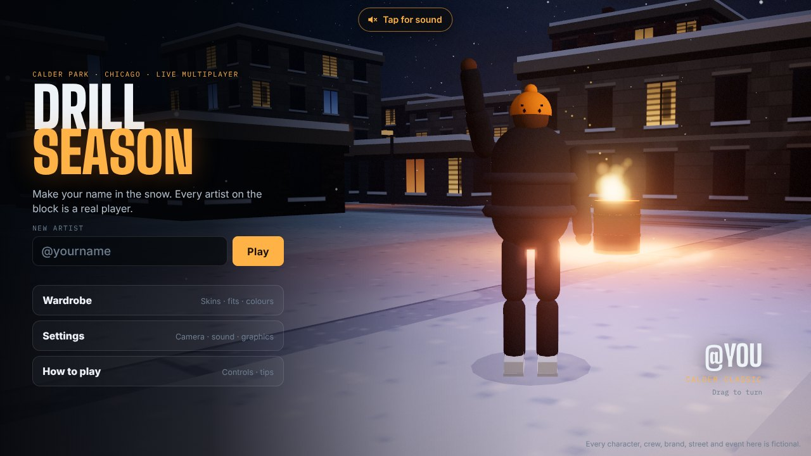
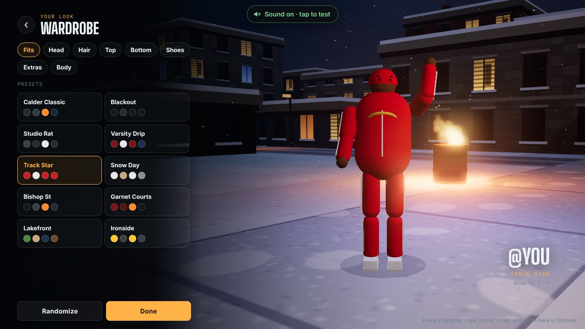
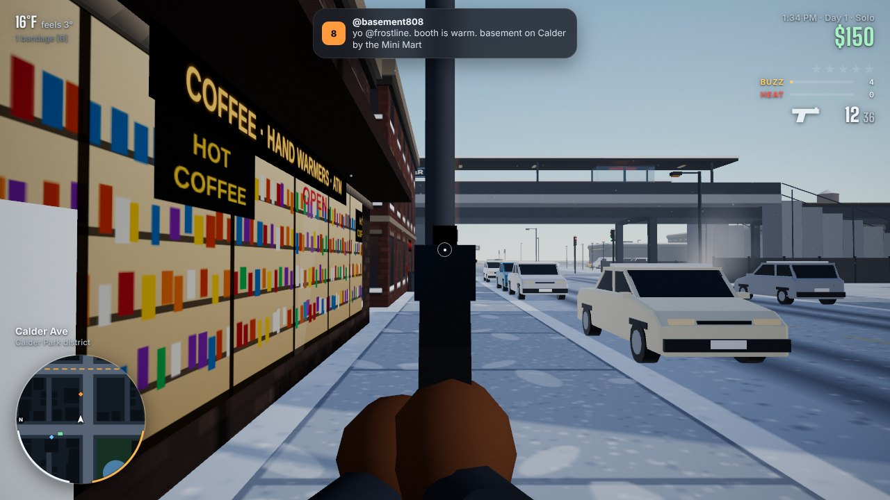
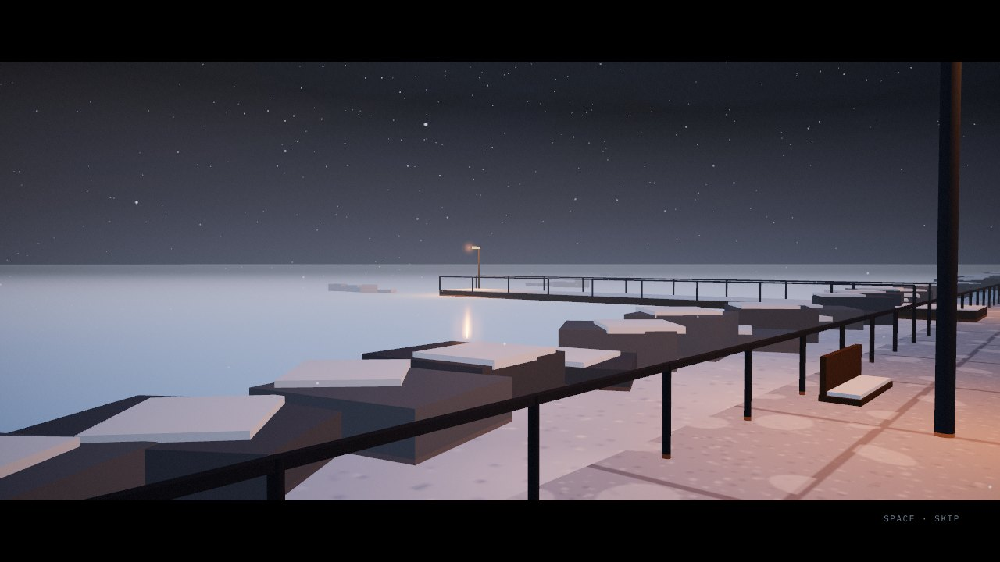
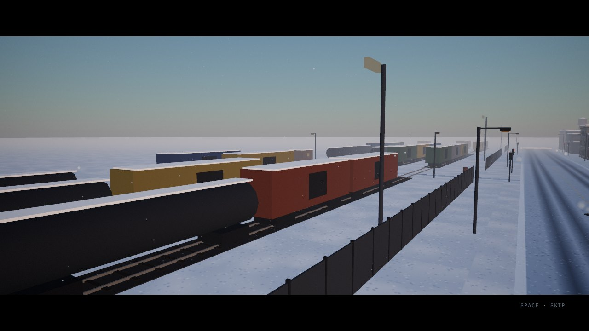
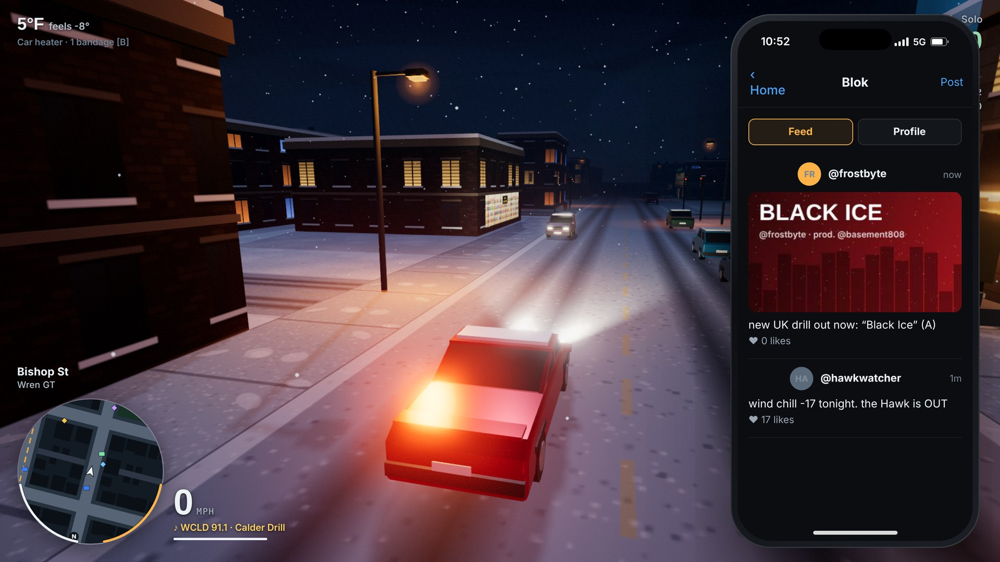

# Drill Season

A multiplayer action game, played in third or first person, set in **Calder Park**, a fictional winter district on Chicago's South/West Side. You pick a username, make beats in a basement studio, build Buzz online, keep your Heat down, and decide which way out you take. Everything runs in one HTML file with [Three.js](https://threejs.org/), and every sound is synthesized in the browser.

All people, crews, places, brands and songs in the game are made up.



| | |
|---|---|
|  |  |
|  |  |
|  |  |
|  |  |
|  |  |

Sound demo: [preview/drill_season_sound_demo.mp3](preview/drill_season_sound_demo.mp3)

## Play

Play it at **https://autoemfoco123-hash.github.io/drill-season/** once GitHub Pages is on, or serve this folder from any static host. Tap or click once to turn sound on; browsers do not allow sound before that.

### Multiplayer

Everyone who opens the page lands on the same block, with no account and no server:

- **On GitHub Pages or any web host:** players connect peer-to-peer over WebRTC. Public [Nostr](https://nostr.com/) relays are only used to introduce players to each other, through [Trystero](https://github.com/dmotz/trystero), which is embedded in `index.html`. Positions, shots, cars and radio stations stream directly between browsers. Profiles, charts and Blok posts are shared with whoever is online and remembered on each device.
- **As a Claude artifact:** `dist/artifact.html` uses the artifact's live room and shared database instead.

Notes on the peer-to-peer mode:

- Opening `index.html` as a local file runs solo. Serve it over `https://` or `http://localhost`.
- It suits small groups, up to about a dozen players, because every player connects to every other player.
- Some strict networks, such as certain mobile carriers and corporate firewalls, block direct connections. Players on those networks play solo.
- Shots and damage are checked by each player's own browser, so it is built for playing with friends, not for strangers who might cheat.
- To use your own Nostr relays, set `window.DS_RELAYS = ['wss://your.relay']` before the game script runs.

### Controls

| Action | Keyboard / mouse |
|---|---|
| Move, sprint | W A S D, Shift |
| Aim, shoot | Right mouse, left mouse |
| Jump (handbrake in a car), crouch | Space, C |
| First / third person | V |
| Wave | G |
| Reload / next radio station | R |
| Switch weapon | Q |
| Enter or leave a car | F |
| Horn | H |
| Interact, hold to walk away from a standoff | E |
| Bandage | B |
| Phone | Tab or P |
| Pause | Esc |
| Studio rhythm lanes | D F J K |

Phones and tablets get on-screen controls.

## What is in it

- **Your look:** a wardrobe with 10 preset fits and mix-and-match pieces:
  - 7 hairstyles and 9 kinds of headwear (beanie, cap, durag, bucket hat, hood, ski mask, headphones)
  - 6 jackets, 4 pants styles, 3 shoe types
  - chains, watches, shades, bags, beards, skin tones and builds, with colour palettes

  Your look is saved, and other players see it live, including changes.
- **First person:** press V for an eye-level view with your own sleeves and gun, aim-down-sights and recoil, or a driver's-seat view with a turning wheel and speedometer.
- **Main menu:** your character on a lit stage under the L, with Continue, Wardrobe, Settings and How to play.

- **A shared day and night:** a full day passes in 24 real minutes, and everyone in the room sees the same time. Trains and traffic lights follow the same clock.
- **The district:** 500 m across on a 5×5 street grid: Calder Ave, Bishop St, Low End Rd, the elevated L with scheduled trains, a park with a frozen pond, a corner store, a rec center, a hospital, a police station and a car dealer. Four outer districts:
  - **Shore Dr lakefront:** a promenade, a pier, and a frozen lake you can walk out on.
  - **Garnet Courts:** brick towers and a basketball court where you can shoot around.
  - **Ironside Fuel:** a 24-hour gas station and mini mart on the industrial strip.
  - **Kessler rail yard:** freight cars and floodlights.
- **Cars:** 8 low-poly models you can drive, traffic that stops at signals, a garage and a dealer, carjacking, crashes.
- **Police and blood:** a 5-star wanted level, cruisers and officers, arrests, blood marks and pools.
- **Cutscenes:** letterboxed, in-engine and skippable.
- **Social media:** Blok, a feed on your in-game phone. Post photos and selfies and gain followers; posts and charts are shared with the other players.
- **The studio:** a rhythm game over generated Chicago, UK or NY drill beats. Tracks get titles and chart on Blok.
- **Combat:** cover-based fights, fictional guns, and a workbench for parts and finishes.
- **The Hawk:** wind chill and a warmth meter. Fire barrels, steam vents and going indoors keep you alive.
- **Endings:** several endings based on how you play, and you can keep playing after one.

### Sound

Every sound is made in the browser by code; there are no recordings.

- **3D sound:**
  - HRTF positioning in 3D.
  - Air absorption: far sounds lose their highs.
  - Speed-of-sound delay.
  - Walls muffle what's behind them.
  - Gunshots echo off the buildings on either side.
  - Street and room reverb.
- **Effects:** gunshots per weapon, shell casings, bullet impacts and near-miss snaps, snow, slush and steel footsteps for everyone nearby, engines with a 5-speed gearbox, tyres and skids, sirens that change pitch as they pass, police radio, the L train, wind, fire, steam and distant city life.
- **Music:** a drill drum kit, distorted sliding 808s, bells, piano, choir, strings, flute and vocal chops. Four radio stations play full arranged songs in sync for every player, plus your own tracks. On foot, a background score builds with police heat.

## Build

The game is split into modules in `src/` and concatenated into one file:

```bash
./build.sh
```

This writes `index.html` (standalone) and `dist/artifact.html` (Claude artifact format). The module order is in `src/parts.txt`.

Real recordings can replace any built-in sound: list the names in `AUDIO_PACK` in `src/20_audio.js` and put `audio/<name>.mp3` next to the page.
