# Drill Season

A multiplayer action game, played in third or first person, set in **Calder Park**, a fictional winter district on Chicago's South/West Side. You pick a username, make beats in a basement studio, build Buzz online, keep your Heat down, and decide which way out you take. The game is one HTML file built with [Three.js](https://threejs.org/), plus an `assets/` folder of free CC0 photo-scanned textures, skies and props. Every sound is synthesized in the browser.

All people, crews, places, brands and songs in the game are made up.


| | |
|---|---|
|  |  |
|  | 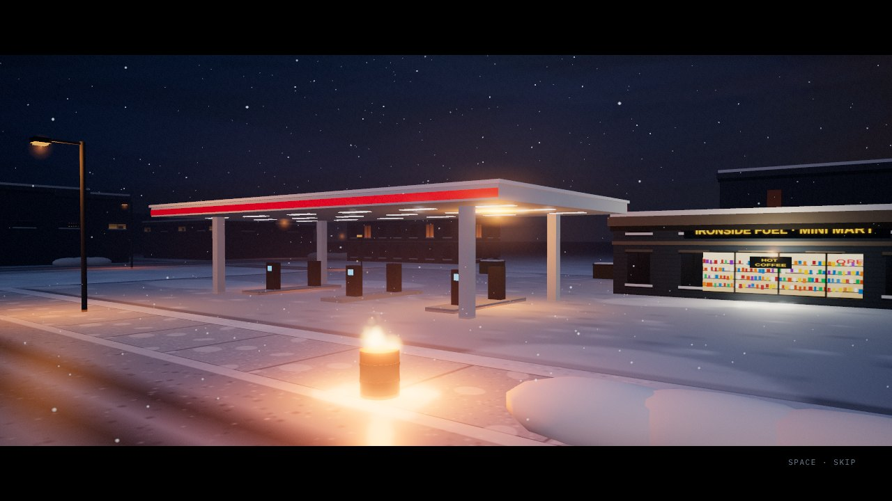 |
| 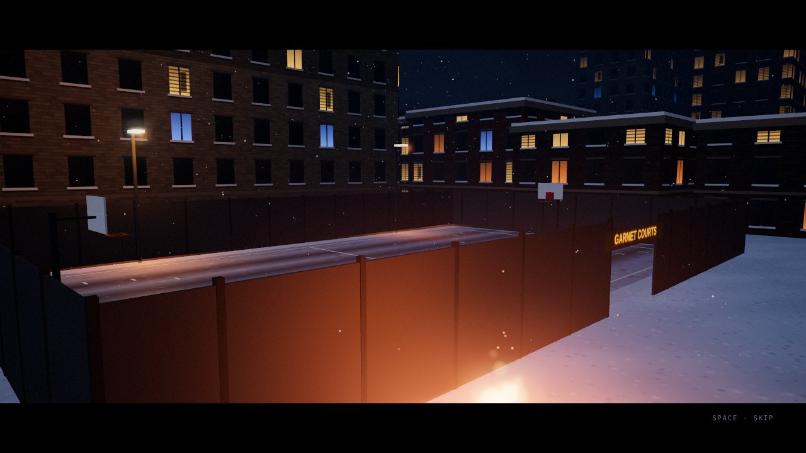 |  |
| 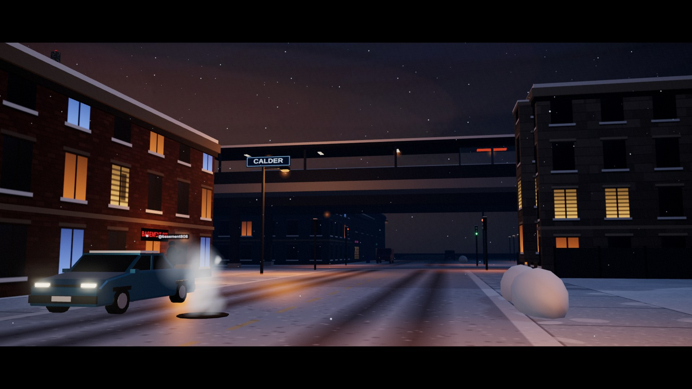 | 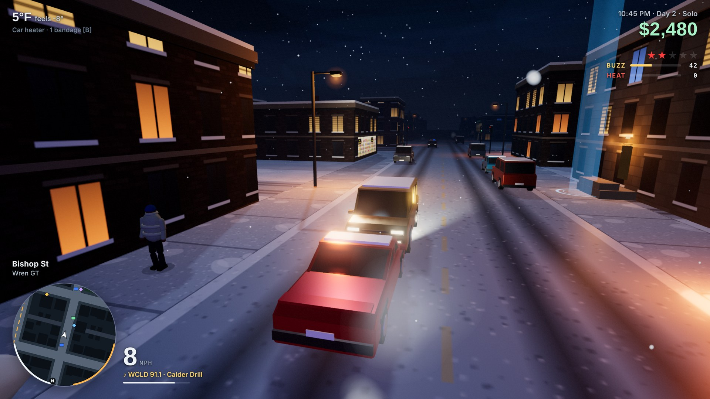 |
|  |  |
| 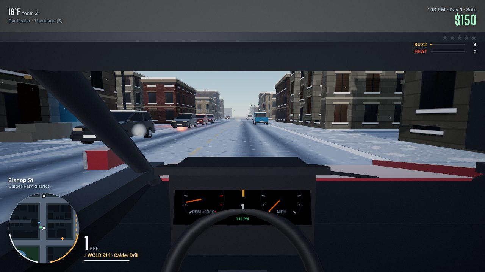 | 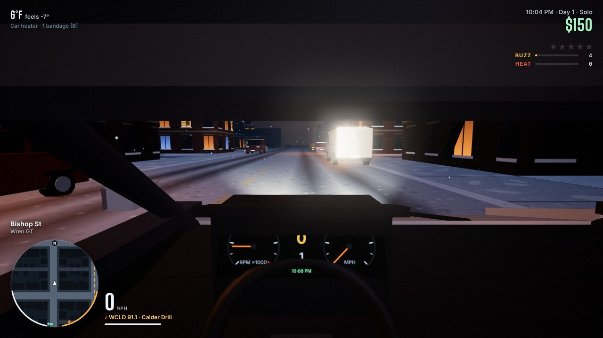 |
| 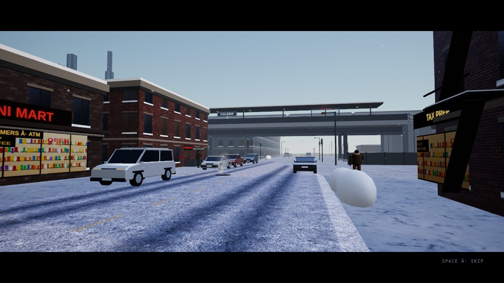 | 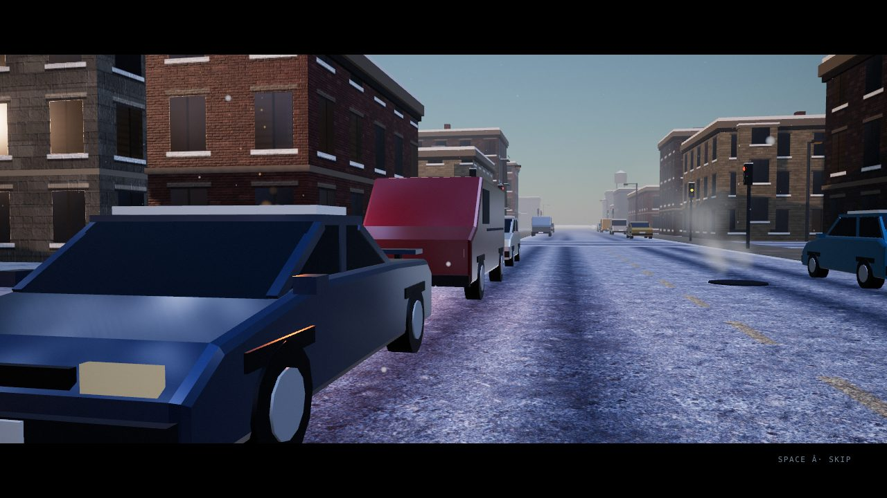 |
| 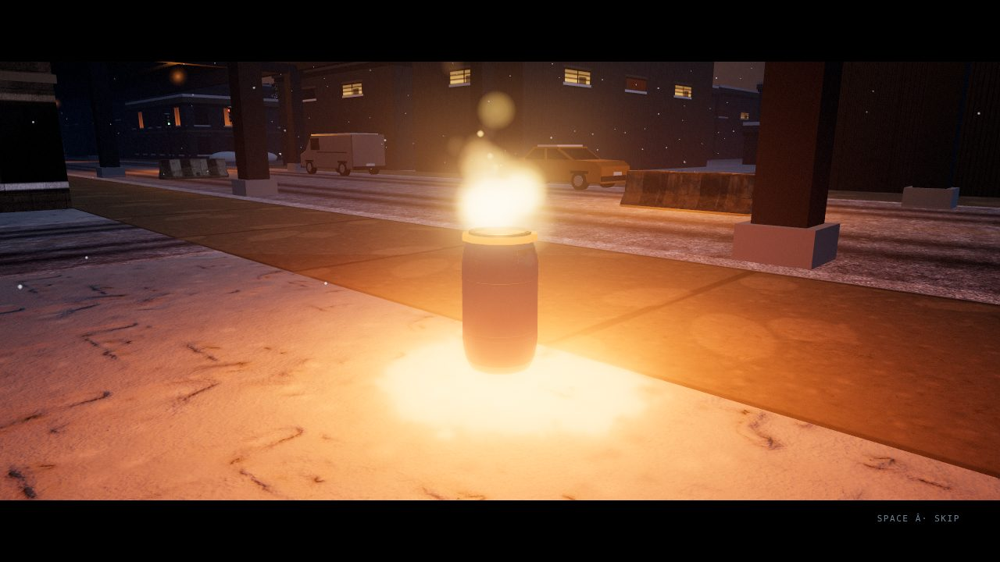 | 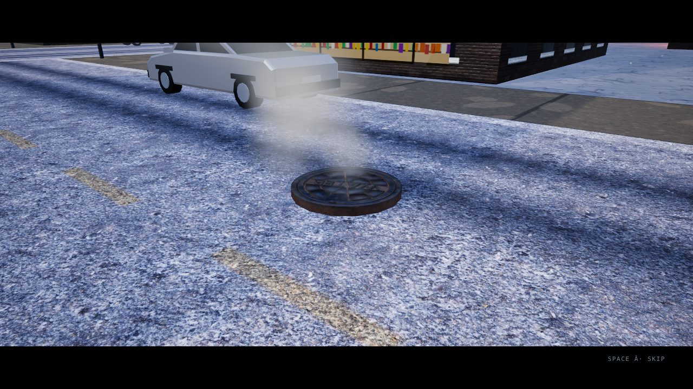 |
| 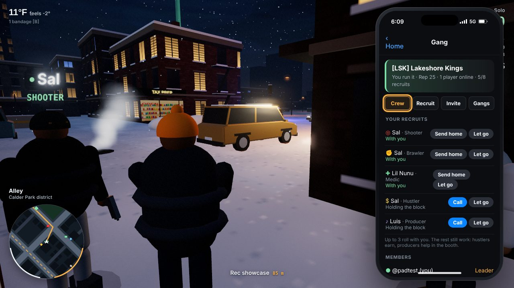 | 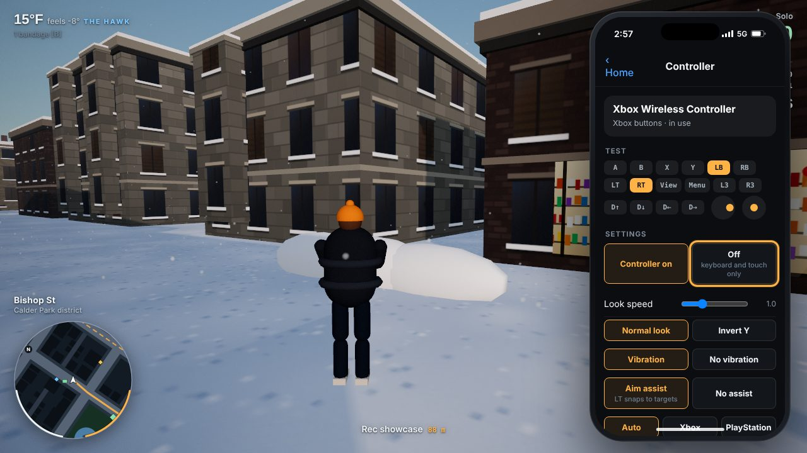 |

Sound demo: [preview/drill_season_sound_demo.mp3](preview/drill_season_sound_demo.mp3)

## Play

Play it at **https://autoemfoco123-hash.github.io/drill-season/** once GitHub Pages is on, or serve this folder from any static host. Tap or click once to turn sound on; browsers do not allow sound before that.

### Consoles

- **Xbox (One and Series X|S):** open the page in Microsoft Edge on the console and play with the controller. The game asks Edge to pass the controller to the page; if it still moves a cursor, open the Edge menu and turn on game controller mode. On Xbox the game draws at a lower resolution, with no shadows and fewer people and cars, and the resolution keeps adjusting to hold the frame rate (the glow effect turns off if it is still too slow). If Edge takes the GPU away and does not give it back, or the 3D renderer keeps failing, the game switches to its simple software renderer and keeps going. You can also pick **Simple** under Graphics in the phone's Settings.
- **PlayStation 4:** the PS4 web browser turns off WebGL, the 3D graphics most web games use. Drill Season switches to its own software renderer there: the same city, people, cars and day and night, drawn in plain JavaScript at a lower resolution that adjusts itself to keep the game moving. Play with a USB keyboard (WASD to move, arrow keys to look) or with the on-screen buttons and the PS4 cursor; a controller works too if the browser passes it to the page.
- Older browsers without modern JavaScript or import maps (the PS4 browser, older Safari, some TV browsers) load `drill-season-legacy.js`, the same game compiled to an older standard. Any browser with WebGL turned off uses the software renderer.

### PC (Godot)

`godot/` is a native version made with Godot 3 (GLES2). It runs on old graphics chips such as first-generation Intel HD (Iron Lake), on Linux and Windows.

- It has the same city, cars, guns, sounds and radio stations, which are exported from the web build by `tools/export-godot.js` and `tools/record-radio.js`.
- It uses the same save format. To move your progress, open the phone in the web game and go to **Settings → Export my progress**. That downloads `drill-season-save.json`. Then click **Import progress from the web game** in the Godot version.
- It has everything the web game has: the story, cutscenes and endings, the studio rhythm game, the workbench, Blok, the moving L train and the cold. On top of that it adds ragdolls, emotes, snowball fights, a character creator, a redesigned HUD and online play between Godot copies (host or join by IP or on the local network).

`godot/README.md` (in Portuguese) explains how to run it and lists the controls.

### Multiplayer

Everyone who opens the page lands on the same block, with no account and no server:

- **On GitHub Pages or any web host:** players connect peer-to-peer over WebRTC. Public [Nostr](https://nostr.com/) relays are only used to introduce players to each other, through [Trystero](https://github.com/dmotz/trystero), which is embedded in `index.html`. Positions, shots, cars and radio stations stream directly between browsers. Profiles, charts and Blok posts are shared with whoever is online and remembered on each device.
- **As a Claude artifact:** `dist/artifact.html` uses the artifact's live room and shared database instead.

Notes on the peer-to-peer mode:

- Opening `index.html` as a local file runs solo. Serve it over `https://` or `http://localhost`.
- It suits small groups, up to about a dozen players, because every player connects to every other player.
- Some strict networks, such as certain mobile carriers and corporate firewalls, block direct connections. Players on those networks play solo.
- Shots and damage are checked by each player's own browser, so it is built for playing with friends, not for strangers who might cheat.
- To use your own Nostr relays, set `window.DS_RELAYS = ['wss://your.relay']` before the game script runs.

### Controls

| Action | Keyboard / mouse |
|---|---|
| Move, sprint | W A S D, Shift |
| Aim, shoot | Right mouse, left mouse |
| Jump (handbrake in a car), crouch | Space, C |
| First / third person | V |
| Wave | G |
| Middle finger (hold to keep it up, works in a car too) | T |
| Fists (hold aim to block) | 4, or Q past your guns |
| Reload / next radio station | R |
| Switch weapon | Q |
| Enter or leave a car | F |
| Horn | H |
| Interact, hold to walk away from a standoff | E |
| Bandage | B |
| Phone | Tab or P |
| Pause | Esc |
| Studio rhythm lanes | D F J K |

Phones and tablets get on-screen controls.

**Controllers** (Xbox, PlayStation and most others) work as soon as you press a button:

| Action | Controller |
|---|---|
| Move, look | Left stick, right stick |
| Shoot or punch, aim or block | RT, LT |
| Jump, crouch, reload | A, B, X |
| Enter or leave a car | Y |
| Next weapon or fists | LB |
| Use, hold to walk away, recruit | RB |
| Sprint, first / third person | L3, R3 |
| Phone, bandage, wave, middle finger | D-pad up, down, left, right |
| Pause, map | Menu, View |
| Drive: gas, brake, handbrake, horn | RT, LT, A, B |

In menus, on the phone and on the title screen, the D-pad moves a highlight, A selects and B goes back. The **Controller** app on the phone tests every button and sets look speed, invert Y, vibration, aim assist and Xbox or PlayStation button names.

## What is in it

- **Your look:** a wardrobe with 10 preset fits and mix-and-match pieces:
  - 7 hairstyles and 9 kinds of headwear (beanie, cap, durag, bucket hat, hood, ski mask, headphones)
  - 6 jackets, 4 pants styles, 3 shoe types
  - chains, watches, shades, bags, beards, skin tones and builds, with colour palettes

  Your look is saved, and other players see it live, including changes.
- **First person:** press V for an eye-level view with your own sleeves and gun, aim-down-sights and recoil. In a car you sit in a real cockpit shaped to each model: hood in the car's paint, dashboard, a rev counter and speedometer that work, a radio display, mirrors, pillars and your hands on a wheel that turns.
- **Main menu:** your character on a lit stage under the L, with Continue, Wardrobe, Settings and How to play.

- **Real-world materials:** photo-scanned snow, slushy asphalt, concrete, brick, stone, siding and corrugated metal, with normal and roughness maps. Windows are glossy, cars have clear-coat paint, and day and night skies come from real HDR photos of city streets.
- **Scanned props:** fire barrels, fire hydrants, jersey barriers, manhole covers, trash bags and bins. Assets load after the game starts; if they cannot load (for example when the page is opened as a local file), the game uses its own simple shapes.
- **A shared day and night:** a full day passes in 24 real minutes, and everyone in the room sees the same time. Trains and traffic lights follow the same clock.
- **The district:** 500 m across on a 5×5 street grid: Calder Ave, Bishop St, Low End Rd, the elevated L with scheduled trains, a park with a frozen pond, a corner store, a rec center, a hospital, a police station and a car dealer. Four outer districts:
  - **Shore Dr lakefront:** a promenade, a pier, and a frozen lake you can walk out on.
  - **Garnet Courts:** brick towers and a basketball court where you can shoot around.
  - **Ironside Fuel:** a 24-hour gas station and mini mart on the industrial strip.
  - **Kessler rail yard:** freight cars and floodlights.
- **Cars:** 8 low-poly models you can drive, traffic that stops at signals, a garage and a dealer, carjacking, crashes.
- **Police and blood:** a 5-star wanted level, cruisers and officers, arrests, blood marks and pools.
- **Cutscenes:** letterboxed, in-engine and skippable.
- **Social media:** Blok, a feed on your in-game phone. Post photos and selfies and gain followers; posts and charts are shared with the other players.
- **The studio:** a rhythm game over generated Chicago, UK or NY drill beats. Tracks get titles and chart on Blok.
- **Combat:** cover-based fights, fictional guns, and a workbench for parts and finishes.
- **Fists:** put the gun away and fight hand to hand: jab, cross and a heavy hook, with a guard that blocks most of a punch. People can be knocked out and get back up; some swing back. Punches work on other players too.
- **Gangs:** start your own from the **Gang** app with a name, a tag and a colour. Recruit people off the street (they wear a RECRUIT tag; walk up and press E) or from the app:
  - **Brawler:** fights hand to hand.
  - **Shooter:** backs you up in gunfights.
  - **Medic:** patches you up.
  - **Lookout:** calls out police; Wanted cools off faster.
  - **Hustler:** earns cash every in-game hour.
  - **Producer:** your tracks earn more Buzz.

  Up to three roll with you, and they get in your car with you. Rivals shoot at them too, and if they go down they spend a few minutes at Calder General.

  Online, other players see your tag and your crew on the street. You can invite them to your gang, and there is no friendly fire inside a gang. A board ranks every gang on the block. Gang names that match real gangs or contain slurs are refused.
- **The Hawk:** wind chill and a warmth meter. Fire barrels, steam vents and going indoors keep you alive.
- **Endings:** several endings based on how you play, and you can keep playing after one.

### Sound

Every sound is made in the browser by code; there are no recordings.

- **3D sound:**
  - HRTF positioning in 3D.
  - Air absorption: far sounds lose their highs.
  - Speed-of-sound delay.
  - Walls muffle what's behind them.
  - Gunshots echo off the buildings on either side.
  - Street and room reverb.
- **Effects:** gunshots per weapon, shell casings, bullet impacts and near-miss snaps, snow, slush and steel footsteps for everyone nearby, engines with a 5-speed gearbox, tyres and skids, sirens that change pitch as they pass, police radio, the L train, wind, fire, steam and distant city life.
- **Music:** a drill drum kit, distorted sliding 808s, bells, piano, choir, strings, flute and vocal chops. Four radio stations play full arranged songs in sync for every player, plus your own tracks. On foot, a background score builds with police heat.

## Build

The game is split into modules in `src/` and concatenated into one file:

```bash
./build.sh
```

This writes `index.html` (standalone) and `dist/artifact.html` (Claude artifact format). The module order is in `src/parts.txt`.

Run `npm install` once first to also build `drill-season-legacy.js`, the compatibility build (it uses esbuild and three.js from npm). Add `?lite` to the page address to try the software renderer in any browser.

`assets/` must sit next to the page. Every asset in it is CC0 from [Poly Haven](https://polyhaven.com); `assets/CREDITS.md` lists each one with a link.

Real recordings can replace any built-in sound: list the names in `AUDIO_PACK` in `src/20_audio.js` and put `audio/<name>.mp3` next to the page.
