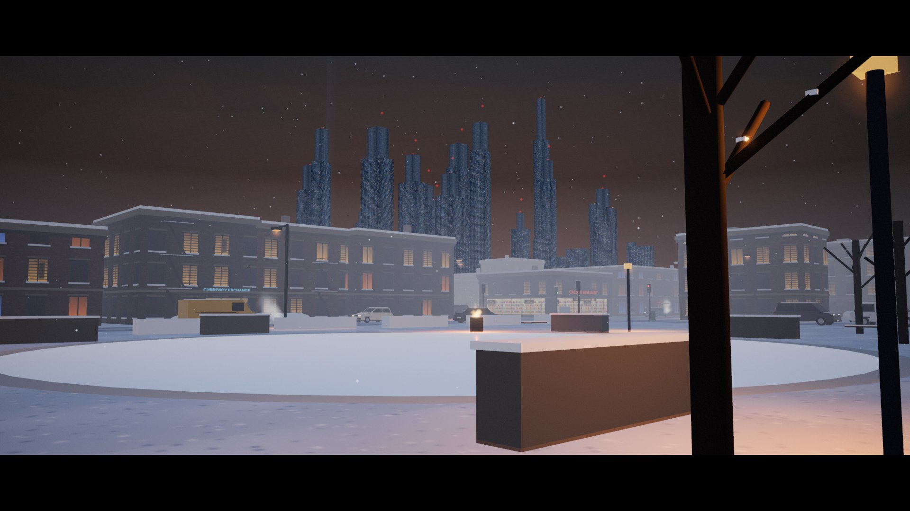
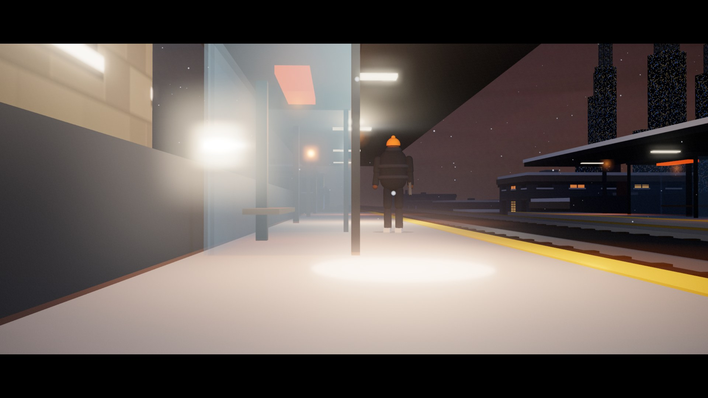

# Drill Season

A multiplayer third-person action game set in **Calder Park**, a fictional winter district on Chicago's South/West Side. You pick a username, make beats in a basement studio, build Buzz online, keep your Heat down, and decide which way out you take. Everything runs in one HTML file with [Three.js](https://threejs.org/), and every sound is synthesized in the browser.

All people, crews, places, brands and songs in the game are made up.


| | |
|---|---|
|  |  |
|  |  |

Sound demo: [preview/drill_season_sound_demo.mp3](preview/drill_season_sound_demo.mp3)

## Play

Open `index.html` in a browser, or serve the folder from any static host (GitHub Pages works as-is). Tap or click once to turn sound on; browsers do not allow sound before that.

**Multiplayer** uses the live rooms and shared database of Claude artifacts. Publish `dist/artifact.html` as a Claude artifact and share it, and everyone who opens it is on the same block. Opened anywhere else, the game runs solo.

### Controls

| Action | Keyboard / mouse |
|---|---|
| Move, sprint | W A S D, Shift |
| Aim, shoot | Right mouse, left mouse |
| Jump (handbrake in a car), crouch | Space, C |
| Reload / next radio station | R |
| Switch weapon | Q |
| Enter or leave a car | F |
| Horn | H |
| Interact, hold to walk away from a standoff | E |
| Bandage | B |
| Phone | Tab or P |
| Pause | Esc |
| Studio rhythm lanes | D F J K |

Phones and tablets get on-screen controls.

## What is in it

- **A shared day and night:** a full day passes in 24 real minutes, and everyone in the room sees the same time. Trains and traffic lights follow the same clock.
- **The district:** Calder Ave, Bishop St, Low End Rd, the elevated L with scheduled trains, a park with a frozen pond, a corner store, a rec center, a hospital, a police station and a car dealer.
- **Cars:** 8 low-poly models you can drive, traffic that stops at signals, a garage and a dealer, carjacking, crashes.
- **Police and blood:** a 5-star wanted level, cruisers and officers, arrests, blood marks and pools.
- **Cutscenes:** letterboxed, in-engine and skippable.
- **Social media:** Blok, a feed on your in-game phone. Post photos and selfies and gain followers; posts and charts are shared with the other players.
- **The studio:** a rhythm game over generated Chicago, UK or NY drill beats. Tracks get titles and chart on Blok.
- **Combat:** cover-based fights, fictional guns, and a workbench for parts and finishes.
- **The Hawk:** wind chill and a warmth meter. Fire barrels, steam vents and going indoors keep you alive.
- **Endings:** several endings based on how you play, and you can keep playing after one.

### Sound

Every sound is made in the browser by code; there are no recordings.

- **3D sound:**
  - HRTF positioning in 3D.
  - Air absorption: far sounds lose their highs.
  - Speed-of-sound delay.
  - Walls muffle what's behind them.
  - Gunshots echo off the buildings on either side.
  - Street and room reverb.
- **Effects:** gunshots per weapon, shell casings, bullet impacts and near-miss snaps, snow, slush and steel footsteps for everyone nearby, engines with a 5-speed gearbox, tyres and skids, sirens that change pitch as they pass, police radio, the L train, wind, fire, steam and distant city life.
- **Music:** a drill drum kit, distorted sliding 808s, bells, piano, choir, strings, flute and vocal chops. Four radio stations play full arranged songs in sync for every player, plus your own tracks. On foot, a background score builds with police heat.

## Build

The game is split into modules in `src/` and concatenated into one file:

```bash
./build.sh
```

This writes `index.html` (standalone) and `dist/artifact.html` (Claude artifact format). The module order is in `src/parts.txt`.

Real recordings can replace any built-in sound: list the names in `AUDIO_PACK` in `src/20_audio.js` and put `audio/<name>.mp3` next to the page.
